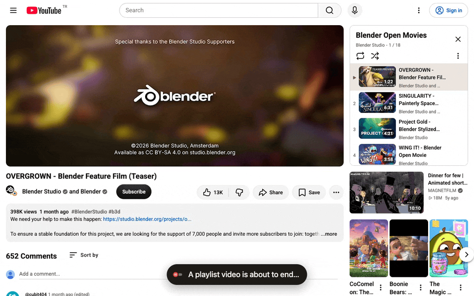

<h1> Watch Later Autoplay Stopper</h1>

A small browser extension that stops YouTube from jumping to the next video when a Watch Later video ends, so you can stay and read the comments.



<sub>Recorded on a public playlist with the "All playlists" option. Watch Later behaves the same.</sub>

## Why

YouTube always plays the next video in a playlist, and its Autoplay switch doesn't apply to playlists. Scroll down to the comments as a Watch Later video ends and you're whisked off to the next one. Go back, and YouTube starts the video from the beginning, so you have to scrub to the end again.

With this extension, the video simply ends and you stay on it. When you're ready, press **Next** in the player (or <kbd>Shift</kbd>+<kbd>N</kbd>).

## Install

- **Chrome Web Store:** coming soon.
- **Manually** (Chrome, Brave, Edge, and other Chromium browsers):
  1. Download or clone this repository.
  2. Open `chrome://extensions` (or `brave://extensions`) and turn on **Developer mode**.
  3. Click **Load unpacked** and select the repository folder.

## Options

Click the toolbar icon to turn the extension on or off and choose where it applies: **Watch Later only** (default) or **All playlists**.

## How it works

When a playlist video ends, YouTube's playlist manager checks an internal "can auto-advance" flag and then navigates to the next video. The extension keeps that flag off on the playlists you choose, and as a second safeguard drops YouTube's automatic "go to next video" navigation. Your own clicks on Next aren't affected.

These are YouTube internals, not a public API. If an update breaks the extension, please [open an issue](https://github.com/ibrahimcavdar/watch-later-autoplay-stopper/issues).

## Privacy

No analytics, no tracking, no network requests. The extension only stores your two settings. See [PRIVACY.md](PRIVACY.md).

## Development

Plain JavaScript, Manifest V3, no build step.

```sh
./scripts/validate-extension.sh   # syntax, manifest, and translation checks
./scripts/package-extension.sh    # store-ready ZIP in dist/
```

## License

[MIT](LICENSE)
